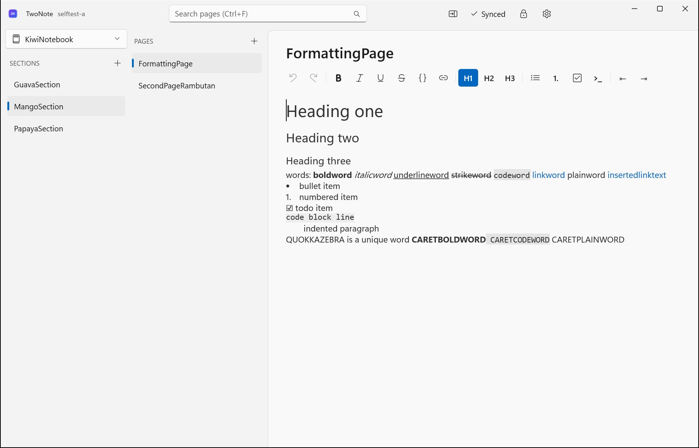
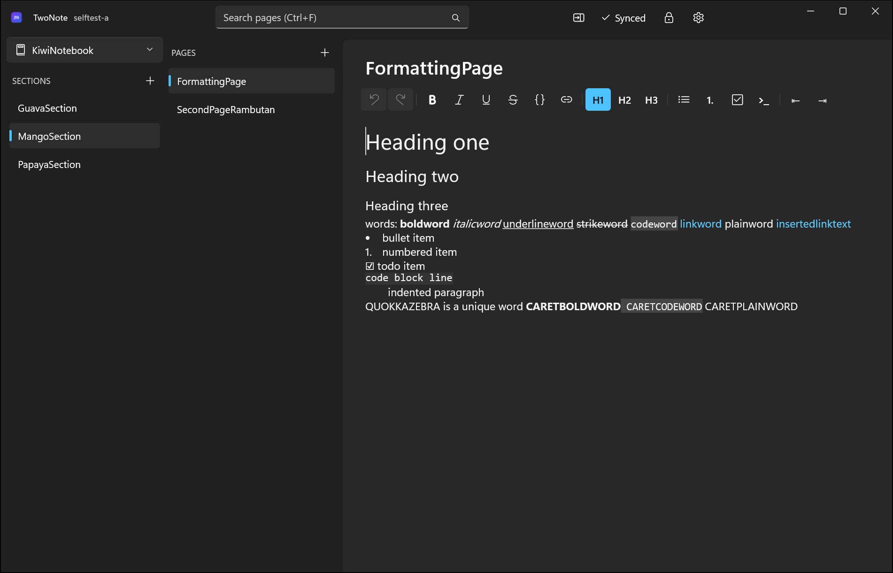
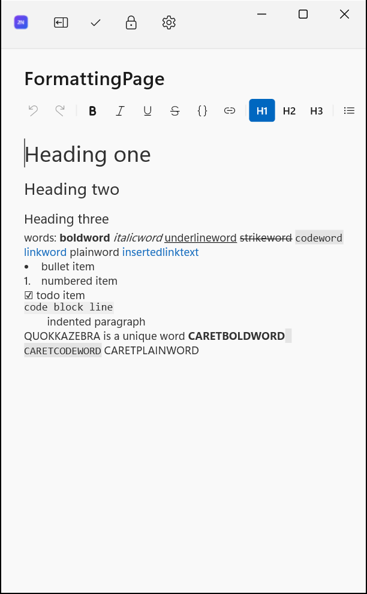

# TwoNote

A simpler OneNote for Windows, iPhone, iPad and Mac that you host yourself. Notes are end-to-end encrypted: the server
only ever stores ciphertext, and they can only be decrypted on your own devices with your master
password plus a Secret Key (the model 1Password uses).



| Dark theme | Narrow, zoomed, panes hidden |
|---|---|
|  |  |

## What it does

- Notebooks, sections and pages, with rich-text pages: headings, bold, italic, underline,
  strikethrough, inline code, links, bullet and numbered lists, to-dos, code blocks, indent.
- Offline first. Every device keeps a full encrypted copy and works with the server unreachable.
- Live merge. Edits made on two devices, online or offline, merge automatically (Yjs CRDT);
  there are no conflict copies.
- One Docker container for the server, with SQLite in a single volume.
- Typing `- `, `1. ` or `[] ` at the start of a line starts a list; formatting survives a paste
  from apps that copy HTML.
- Search, light and dark themes, zoom, a hideable sidebar, auto-lock.

## Read this before trusting it with anything

- **The cryptography has not been audited.** It is built from standard primitives (libsodium:
  Argon2id, XChaCha20-Poly1305, Ed25519, plus HKDF) and the design is written down in
  [docs/PROTOCOL.md](docs/PROTOCOL.md), but nobody independent has reviewed it.
- **There is no recovery.** Lose the master password, or every copy of the Secret Key, and the
  notes cannot be decrypted by anyone. The app makes you save an Emergency Kit for this reason.
- **It is early software**: single user, no installer, no automatic updates, and the iOS and Mac
  apps must be built from source.
- The server is meant for a LAN or VPN. It speaks plain HTTP; put a TLS reverse proxy in front
  of it for anything else.

Known gaps are listed under "Open items" in [docs/DESIGN.md](docs/DESIGN.md).

## Run the server

```
docker build -f deploy/Dockerfile -t twonote-server:latest .
docker run -d --name twonote --restart unless-stopped -p 8080:8080 -v twonote-data:/data twonote-server:latest
```

The first client to connect creates the account; registration then closes. Back up the `/data`
volume: it holds only ciphertext. [deploy/README.md](deploy/README.md) covers Docker Compose, backup and
restore.

## Build and install the client

Needs only the [.NET 10 SDK](https://dotnet.microsoft.com/download) on Windows 11 (Windows 10 should work but is untested). No
Visual Studio, account or sign-in.

```
dotnet publish src/TwoNote.App -c Release -r win-x64 --self-contained true -o "%LOCALAPPDATA%\Programs\TwoNote"
```

Run `TwoNote.exe` from that folder, enter the server address, and create the account. On other
PCs choose "Add this device" and enter the password and Secret Key.

`--profile <name>` runs a second, fully separate instance, which is how two "devices" can be
tried on one PC.

## iPhone, iPad and Mac

Native Swift clients for iOS and macOS live in [`ios/`](ios/README.md): SwiftUI apps with a
TextKit 2 editor, Face ID / Touch ID unlock, auto-lock, search, a Share extension and a widget.
They speak the same protocol, so they sync with the same server and the Windows client.

There is no App Store build: you build them yourself on an Apple Silicon Mac with Xcode, XcodeGen
and Rust (for the y-crdt library). Your own Apple developer team goes in
`ios/Config/Local.xcconfig`; without one you can still build for the simulator and run the tests.
[ios/README.md](ios/README.md) has the steps.

## Develop

```
dotnet test TwoNote.slnx
dotnet run --project src/TwoNote.App
```

| Path | What |
|---|---|
| `src/TwoNote.Core` | Portable .NET library: crypto, key hierarchy, documents, local store, sync client |
| `src/TwoNote.Server` | ASP.NET Core + SQLite server: auth, ciphertext log, WebSocket notifications |
| `src/TwoNote.App` | WinUI 3 Windows client |
| `ios/` | Native iOS and macOS clients (Swift); see [ios/README.md](ios/README.md) |
| `deploy/` | Dockerfile, compose file, deployment notes |
| `docs/DESIGN.md` | Architecture, decisions, open items |
| `docs/PROTOCOL.md` | Wire protocol, crypto and document format: the contract for other clients |
| `docs/test-vectors.json` | Crypto test vectors every client implementation must reproduce |

`pwsh src/TwoNote.App/run-selftest.ps1` drives the real app against a temporary server container.
It opens windows on the desktop, so run it on a PC nobody is using.

## Licence

[MIT](LICENSE). Dependencies are MIT, Apache-2.0, ISC or public domain, with one exception: the
Windows App SDK (WinUI 3) ships under the proprietary Microsoft Software License Terms (free, no
account needed). Details are in [docs/DESIGN.md](docs/DESIGN.md).

TwoNote is an independent project and is not affiliated with Microsoft or OneNote.
